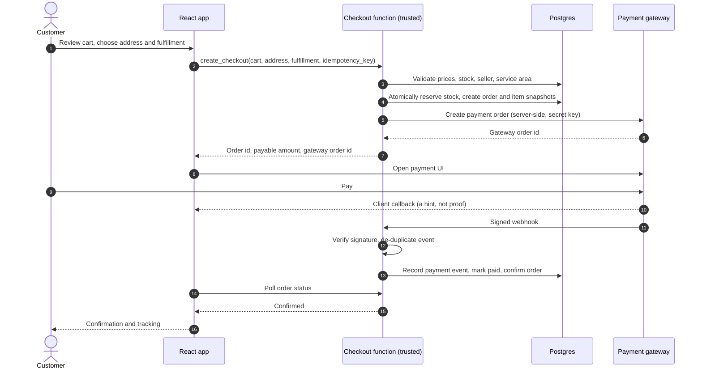
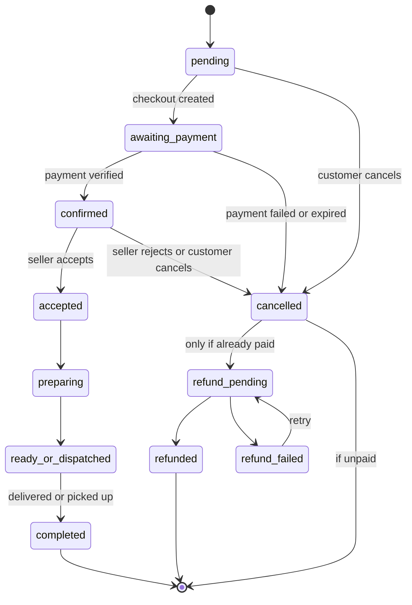
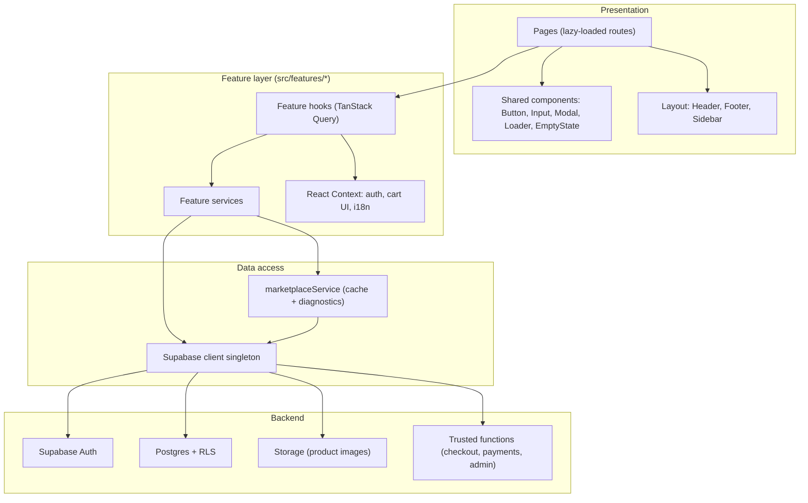
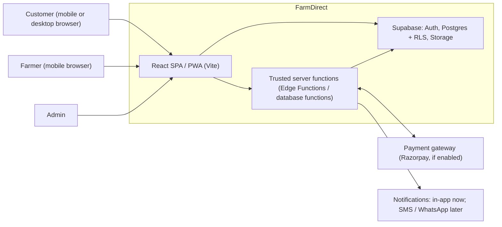
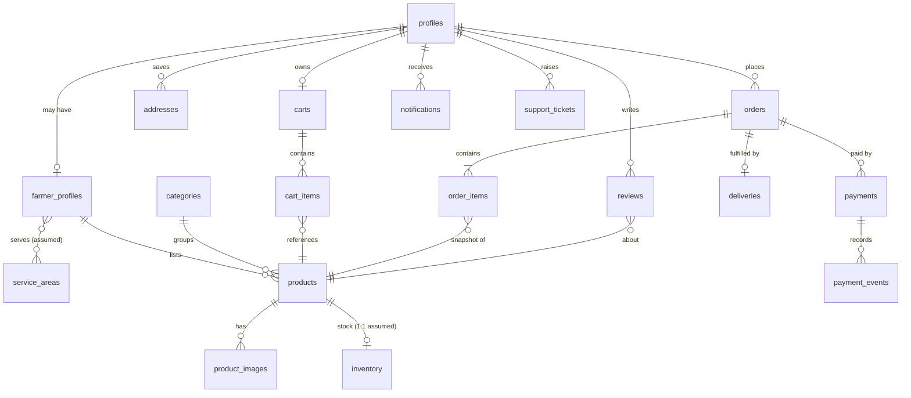
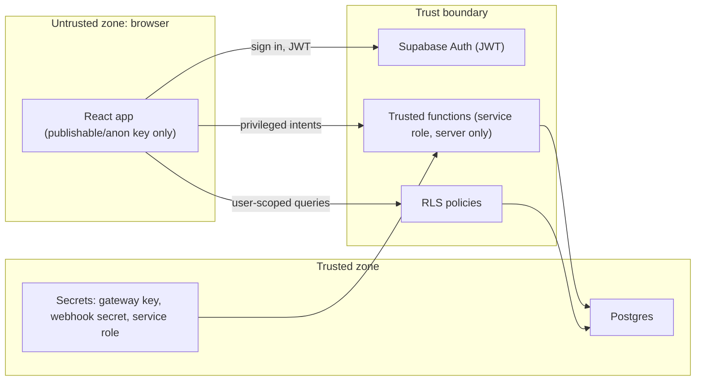
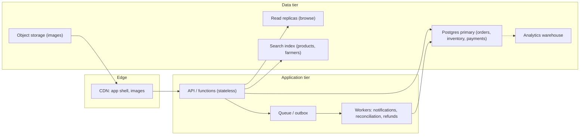

# FarmDirect — Product & System Design

| | |
|---|---|
| **Document** | `docs/design.md` |
| **Version** | 1.0 (baseline draft) |
| **Date** | 2026-10-18 |
| **Product** | FarmDirect, an India-focused farmer-to-consumer agricultural marketplace |
| **Platform** | Mobile-first web app, PWA-ready |
| **Stack (reported)** | React, TypeScript, Vite, React Router, TanStack Query, plain CSS + CSS variables, Supabase, Vitest |
| **Source of facts** | The supplied FarmDirect product brief. **The repository, migrations and RLS policies were not inspected.** |

## How to read this document

Every non-trivial statement carries a status tag, so facts are never confused with plans.

| Tag | Meaning |
|---|---|
| **[Reported]** | Stated in the supplied project report; not independently verified against the repo. |
| **[Proposed]** | A recommendation in this document. Not an existing feature. |
| **[Decision]** | Needs a stakeholder decision before implementation. |
| **[Rule]** | A standing project rule (for example, no Tailwind). Binding on all contributors and AI agents. |

> **Hard rule for this document:** table names, columns, routes, RLS policies, payment integration status and performance numbers are not invented here. Where the repo has not been inspected, the text says so and gives a verification step (Section 21 and Appendix C).

---

## Table of contents

1. Executive summary
2. Product vision and target users
3. Business model and product scope
4. Functional requirements
5. User roles and permissions
6. User journeys and state transitions
7. Information architecture and route map
8. UI/UX design system
9. Responsive layouts and important UI states
10. Frontend component architecture
11. Backend architecture and data flow
12. Database relationships and constraints
13. Authentication and authorization
14. RLS and security boundaries
15. Cart, checkout, inventory, orders and payments
16. Cache and offline behavior
17. Performance requirements
18. Testing strategy
19. Deployment and environment configuration
20. Error handling and observability
21. Known limitations, risks and open decisions
22. Implementation roadmap
23. Acceptance criteria
- Appendix A. Scale blueprint ("built for a billion")
- Appendix B. Product ideas that raise trust and adoption
- Appendix C. Sources, assumptions and repo verification checklist

---

## 1. Executive summary

FarmDirect lets farmers list produce and sell directly to nearby consumers, with transparent prices, visible farmer identity and trackable orders. The target user is often on a budget Android phone and an unstable network, so speed, simplicity and Hindi/English support are product requirements, not polish.

**What makes this product succeed or fail** (in priority order):

1. **Trust.** Money, stock and order state must always be correct. A marketplace that oversells, double-charges or shows fake availability loses farmers and customers permanently.
2. **Supply quality.** Verified farmers, honest listings, fresh inventory.
3. **Farmer ease of use.** Onboarding in minutes, product listing in under a minute, in the farmer's language.
4. **Speed on weak devices and networks.**
5. **Maintainability.** A codebase that humans and AI agents can change safely.

**Design stance:**

- The client is untrusted. Price, stock, serviceability, payment state and roles are decided only by trusted server-side code and RLS. **[Rule]**
- Live Supabase data is authoritative. Caches only help browsing. **[Rule]**
- Build the MVP simply, but choose data shapes and boundaries that can scale (Appendix A) without a rewrite. **[Proposed]**

**Biggest known gaps to close before a real launch** (all unverified until the repo is inspected):

| # | Gap | Why it matters |
|---|---|---|
| 1 | RLS policy coverage on all 20 tables | A missing policy is a data breach. |
| 2 | Trusted, atomic, idempotent checkout | Prevents overselling and duplicate orders. |
| 3 | Server-verified payments and webhooks | A frontend success callback is not proof of payment. |
| 4 | Role and verification fields not client-writable | Prevents self-promotion to farmer or admin. |
| 5 | Fixture fallback shown as live data | Customers could order items that do not exist. |
| 6 | Legal/operational answers (liability, refunds, food rules) | Blocks launch regardless of code quality. |

---

## 2. Product vision and target users

### 2.1 Vision

Make buying fresh produce from a known local farmer as easy as ordering from any large app, while giving the farmer a simple tool to run a small digital business.

### 2.2 Problems solved

**Farmers:** limited direct access to buyers, dependence on intermediaries, weak inventory and order tools, complicated digital workflows.
**Consumers:** hard to find nearby fresh produce, little transparency on origin, inconsistent price and availability.

### 2.3 Personas

| Persona | Context | Needs | Design consequence |
|---|---|---|---|
| **Farmer (small holder)** | Budget Android, patchy network, may prefer Hindi, low digital literacy | List produce quickly, know who ordered, get paid reliably | Large touch targets, icon + label, few fields, resume-able forms, Hindi first-class |
| **Urban/semi-urban customer** | Regular smartphone, familiar with quick-commerce apps | Fresh produce, honest price, clear delivery/pickup, easy payment | Familiar cart/checkout patterns, clear ETA only when verified |
| **Rural/semi-urban customer** | Budget phone, limited data | Fast pages, small images, simple language | Strict bundle and image budgets, offline-tolerant browsing |
| **Admin / operations** | Desktop mostly | Verify farmers, moderate listings, resolve payment and order exceptions | Queue-based dashboards, audit trail, strict authorization |

### 2.4 Product principles

1. **Honest by default.** No unverifiable organic, freshness or discount claims.
2. **Simple before clever.** One obvious action per screen.
3. **Server decides money and stock.**
4. **Every state is designed.** Loading, empty, error, offline, success.
5. **Small and fast.** Budget Android is the reference device, not the exception.

---

## 3. Business model and product scope

### 3.1 Marketplace model

FarmDirect is a marketplace connecting independent farmers and customers. The product must always make clear who is the **seller**, the **marketplace operator**, the **payment provider**, the **party delivering or handing over goods**, and the **party handling returns, disputes and refunds**. **[Decision]** The legal answers are open (Section 21).

The platform aims to reduce avoidable intermediaries and improve price transparency. It does **not** promise higher farmer earnings; actual earnings depend on costs, commission, fulfillment and market conditions.

### 3.2 In scope (MVP)

Customer marketplace, farmer onboarding and verification, product and inventory management, cart, checkout, orders and tracking, local fulfillment (pickup and/or local delivery where actually supported), basic administration, security and production validation.

### 3.3 Out of scope (MVP)

National logistics, commodity trading, bidding/auctions, credit or loans, AI price prediction, guaranteed same-day delivery, multi-vendor split payments and automated settlements, warehouse and fleet management. These are future phases (Section 22).

### 3.4 Categories

Initial seed categories **[Reported]**: Vegetables, Fruits, Grains, Pulses, Spices, Dairy. Categories are configuration, not a hard limit. Dairy and other perishables may need special handling rules **[Decision]**.

### 3.5 Product listing data (logical fields)

Product identity and slug, farmer, category, description, images, unit of sale, price per unit, available quantity and stock status, origin/farm location, harvest or freshness info (only if verified), organic/certification info (only if substantiated), moderation/publication status, timestamps. Actual columns must be taken from migrations, not from this list.

### 3.6 Units

Kilogram, gram, quintal, piece, litre, pack/bundle. Store quantity and unit explicitly. Block ambiguous or invalid conversions. **[Proposed]** Keep a single canonical base unit per product and derive display units from it, so cart math never mixes units.

### 3.7 Money rules **[Rule]**

- All internal money is **integer paise** (₹1 = 100 paise).
- Backend is authoritative for price and stock; the client never computes the final payable amount.
- Order items store **price and product snapshots**.
- Rounding rules for discounts, fees and tax must be documented in `docs/BUSINESS_RULES.md` before implementation.
- Confirm the gateway's amount unit explicitly. Razorpay's Orders API takes the smallest currency unit (paise); other gateways may differ.

### 3.8 Revenue (configurable, not hardcoded)

Options: commission per successful order, farmer subscription, delivery/service fee, disclosed promoted placements. Do not enable commission, tax collection or settlements until business rules and backend support exist. **[Decision]**

---

## 4. Functional requirements

Priority: **P0** = required for a safe launch, **P1** = soon after, **P2** = later. "Status" is only **[Reported]** where the brief mentions the page or feature; everything else is **[Proposed]**.

### 4.1 Customer

| ID | Requirement | Pri | Status |
|---|---|---|---|
| FR-C1 | Browse marketplace; search; filter by category, price, availability; sort | P0 | Reported (pages) |
| FR-C2 | Product detail with farmer info, price per unit, available quantity, fulfillment options | P0 | Reported |
| FR-C3 | Cart with quantity controls, subtotal, empty state; revalidated before checkout | P0 | Reported |
| FR-C4 | Address management | P0 | Proposed |
| FR-C5 | Checkout with server-validated totals, fulfillment choice, duplicate-submit protection | P0 | Reported (page) |
| FR-C6 | Payment with server-verified result and safe retry | P0 | Reported (modal) |
| FR-C7 | Order confirmation, tracking and history | P0 | Reported |
| FR-C8 | Reviews after eligible completed orders | P1 | Proposed |
| FR-C9 | Support contact / ticket | P1 | Proposed |
| FR-C10 | Notifications (in-app first; SMS/WhatsApp later) | P1 | Proposed |

### 4.2 Farmer

| ID | Requirement | Pri | Status |
|---|---|---|---|
| FR-F1 | Register, create farmer profile, submit verification info (pending until approved) | P0 | Reported (page) |
| FR-F2 | Create/edit products with images, unit, price, quantity | P0 | Reported (page) |
| FR-F3 | Inventory management with low-stock indicator | P0 | Proposed |
| FR-F4 | Receive and manage orders; accept/reject if supported; update fulfillment status | P0 | Proposed |
| FR-F5 | Dashboard: pending orders, product count, low stock, recent activity | P1 | Reported (page) |
| FR-F6 | Basic sales summary from verified records | P1 | Proposed |
| FR-F7 | Public farmer profile | P1 | Reported (page) |

### 4.3 Admin

| ID | Requirement | Pri | Status |
|---|---|---|---|
| FR-A1 | Farmer verification queue (approve/reject with reason) | P0 | Proposed |
| FR-A2 | Product moderation | P0 | Proposed |
| FR-A3 | Category and service-area management | P1 | Proposed |
| FR-A4 | Order and payment exception views | P0 | Proposed |
| FR-A5 | Support queue | P1 | Proposed |
| FR-A6 | Audit log viewer | P1 | Proposed |
| FR-A7 | Account suspend/reactivate per documented policy | P1 | Proposed |
| FR-A8 | Platform settings (commission, fees) with change history | P1 | Proposed |

### 4.4 Cross-cutting

| ID | Requirement | Pri |
|---|---|---|
| FR-X1 | Hindi and English via the existing translation provider; no hardcoded user-facing strings | P0 |
| FR-X2 | Indian currency formatting (for example ₹1,25,000) | P0 |
| FR-X3 | Accessible UI (WCAG 2.1 AA target) | P0 |
| FR-X4 | Distinct loading, empty, error, offline and stale states on every important page | P0 |

---

## 5. User roles and permissions

Roles: **Guest**, **Customer**, **Farmer** (verified), **Admin**. A user may be both Customer and Farmer.

Permission is enforced **server-side** (RLS and trusted functions). Hiding a button is never access control. **[Rule]**

| Capability | Guest | Customer | Farmer (verified) | Admin |
|---|---|---|---|---|
| View published products, categories, public farmer profiles | Yes | Yes | Yes | Yes |
| Add to cart | Prompt to sign in (exact guest behavior: follow existing app) | Yes | Yes | Yes |
| Place order, pay | No | Yes | Yes (as customer) | Yes |
| View own orders | No | Own only | Own purchases + orders for own products | All (read, audited) |
| Create/edit product | No | No | Own products only | Moderate any |
| Manage inventory | No | No | Own only | Via audited admin action |
| Update fulfillment status | No | No | Own orders, valid transitions only | Exceptions, audited |
| Verify farmers | No | No | No | Yes |
| View payments/payment events | No | Own order payment status | Own order payment status | Yes (restricted) |
| View audit logs, platform settings | No | No | No | Yes (restricted) |

**Rules:**

- Role and verification state are **never** taken from client-submitted fields or editable profile metadata. **[Rule]**
- A farmer without approved verification cannot publish products. **[Proposed]**
- Admin actions that change money, access or visibility write an audit record. **[Proposed]**

---

## 6. User journeys and state transitions

### 6.1 Customer purchase

1. Browse or search → 2. open product → 3. add to cart → 4. review cart → 5. sign in if needed → 6. choose address and fulfillment → 7. request checkout → 8. server validates and creates order → 9. pay (or alternative) → 10. order confirmed only on **verified** state → 11. track → 12. history and review.



### 6.2 Farmer onboarding

Register → authenticate → enter farm details → submit verification info → status **pending** → admin reviews → approved (seller capabilities granted by server) or rejected (reason, can resubmit) → create product → moderation (if required) → published.

### 6.3 Farmer order handling

Notification → review items and fulfillment → accept/reject (if supported) → inventory and cancellation rules applied consistently → update fulfillment status → customer sees authorized status changes → completion → review eligibility.

### 6.4 Payment failure and recovery

Payment stays **pending** until the backend verifies it. Duplicate and late webhooks are idempotent. Failed payments never mark an order paid. Stock follows a documented release policy. The customer sees a clear message and a safe retry.

### 6.5 Order lifecycle (illustrative)

The states below are **illustrative [Proposed]**. Use the project's existing states, or document an intentional migration. Transitions must be enforced in the database or a trusted function, not only in the UI.



**Transition rules:**

| Rule | Detail |
|---|---|
| Who may move state | Customer: cancel (early states only). Farmer: accept, preparing, ready/dispatched, completed on own orders. System: payment-driven transitions. Admin: exceptions, audited. |
| Illegal jumps | For example `pending → completed` is rejected by the database. |
| Stock side effects | Cancellation before fulfillment releases reserved stock exactly once. |
| Money side effects | Cancellation after payment creates a refund obligation. |

---

## 7. Information architecture and route map

### 7.1 Navigation

- **Customer (mobile):** bottom bar with Home, Marketplace, Categories, Cart, Orders, Profile. Touch targets at least 44 × 44 CSS px, icon plus label.
- **Customer (desktop):** responsive header with the same destinations.
- **Farmer:** Dashboard, My Products, Add Product, Inventory, Orders, Farmer Profile, Account Settings.
- **Admin:** Dashboard, Farmer Verification, Products and Moderation, Categories, Service Areas, Orders, Payments, Support, Audit Logs, Platform Settings.

Only expose routes the user's verified role and status allow, and enforce the same on the server.

### 7.2 Pages **[Reported]**

URL paths are **not** invented here. Confirm every path, guard and role from `src/app/routes.tsx` and do not silently change existing URLs. **[Rule]**

| Page | Audience | Auth guard (target) | Path |
|---|---|---|---|
| HomePage | All | Public | Confirm in `routes.tsx` |
| MarketplacePage | All | Public | Confirm |
| ProductDetailsPage | All | Public | Confirm |
| LoginPage | Guest | Public | Confirm |
| CartPage | Customer | Public view; sign-in at checkout (follow existing behavior) | Confirm |
| CheckoutPage | Customer | Authenticated | Confirm |
| OrderConfirmationPage | Customer | Authenticated, own order | Confirm |
| OrderTrackingPage | Customer | Authenticated, own order | Confirm |
| OrderHistoryPage | Customer | Authenticated | Confirm |
| FarmerRegisterPage | Authenticated user | Authenticated | Confirm |
| FarmerDashboard | Farmer | Verified farmer | Confirm |
| AddProductPage | Farmer | Verified farmer | Confirm |
| FarmerPublicProfilePage | All | Public | Confirm |
| AdminDashboard | Admin | Admin (server-enforced) | Confirm |

---

## 8. UI/UX design system

**Source of truth:** `src/styles/variables.css`. Inspect actual tokens before adding any. Do not duplicate tokens. **[Rule]**
**No Tailwind. No CSS-in-JS. No inline styles for ordinary layout or visuals.** Plain CSS and CSS variables only. **[Rule]**

### 8.1 Visual language

Restrained agricultural palette, trustworthy and fresh, not an enterprise-dashboard look. Avoid heavy gradients, blur, large animations and decorative clutter.

| Role | Intent | Token |
|---|---|---|
| Primary | Deep agricultural green: main actions, brand | Map to existing token |
| Secondary | Fresh leaf green: supportive accents | Map to existing token |
| Accent | Warm harvest yellow: highlights, badges | Map to existing token |
| Background | Warm off-white | Map to existing token |
| Surface | White | Map to existing token |
| Text | Dark green-black or charcoal | Map to existing token |
| Muted text | Gray | Map to existing token |
| Success / Error | Accessible green / accessible red | Map to existing token |

**Contrast:** text at least 4.5:1, large text and UI boundaries at least 3:1 (WCAG 2.1 AA). Never use color alone to convey status; pair with icon or text.

### 8.2 Typography

Legible sans-serif with proper Devanagari support. Clear heading hierarchy, readable prices, comfortable body size, no clipping of long Hindi or English product names. Use `font-display` swap and a real fallback stack so text is visible while fonts load. **[Proposed]**

### 8.3 Spacing and layout

Mobile-first, spacing from CSS variables, predictable product grid, stable image aspect ratios (prevents layout shift), readable desktop content width, no horizontal overflow at narrow widths.

### 8.4 Core components

| Component | Notes |
|---|---|
| Button | Variants (primary, secondary, ghost, danger); loading and disabled states; min 44 px height |
| Input | Label, hint, error text, `inputmode` for numeric fields |
| Modal | Focus trap, Escape to close, return focus, accessible name |
| Loader / Skeleton | Skeleton for lists, spinner for short actions |
| EmptyState | Illustration-light, one clear next action |
| ProductCard | Image, name, price and unit, farmer/source, availability, quick-add or view |
| QuantityStepper | Large +/− targets, unit shown, bounded by stock |
| StatusBadge | Order and verification states, icon + text |

### 8.5 Product card priority

1. Image 2. Name 3. Price and unit 4. Farmer/source 5. Availability 6. Action. Show a discount only when real and correctly calculated. Do not overload the card.

### 8.6 Localization

Use the existing translation provider for Hindi and English; keep room for regional languages. Currency via `Intl.NumberFormat` with the `en-IN` locale (lakh/crore grouping). Test long strings and Devanagari wrapping. **[Proposed]**

### 8.7 Accessibility

Semantic HTML, keyboard-operable controls, visible focus, meaningful labels, accessible modals, respect `prefers-reduced-motion`. Test with a screen reader on at least one real Android device. **[Proposed]**

---

## 9. Responsive layouts and important UI states

### 9.1 Breakpoints **[Proposed]**

Design at 360 px first. Suggested steps: 360 (base), 600, 900, 1200. Product grid: 2 columns on phone, 3 on tablet, 4+ on desktop.

### 9.2 Wireframes (mobile, schematic)

```text
Marketplace                     Product detail                  Cart
+------------------------+      +------------------------+      +------------------------+
| [Search...........] 🔍 |      | [  image gallery    ]  |      | Your cart (3)          |
| (Veg)(Fruit)(Grain)... |      | Tomato (Desi)          |      | [img] Tomato  1 kg     |
| Sort ▾    Filter ▾     |      | ₹40 / kg   In stock    |      |   [-] 2 [+]   ₹80      |
| +--------+ +--------+  |      | Farmer: Ramesh ✔       |      | [img] Milk    1 L      |
| | image  | | image  |  |      | Pickup | Local delivery|      |   [-] 1 [+]   ₹60      |
| | Tomato | | Onion  |  |      | Qty [-] 1 [+] kg       |      | Subtotal       ₹140    |
| | ₹40/kg | | ₹30/kg |  |      | [ Add to cart ]        |      | Fees (est.)    ₹20     |
| | [Add]  | | [Add]  |  |      +------------------------+      | Total (est.)   ₹160    |
| +--------+ +--------+  |                                        | [ Checkout ]           |
| Home Shop Cat Cart Me  |                                        +------------------------+
+------------------------+
```

```text
Farmer dashboard (mobile)
+----------------------------+
| Namaste, Ramesh            |
| [Pending orders: 3] [Low stock: 2] |
| New orders                 |
|  #1042  Tomato 5 kg  [Accept]      |
|  #1041  Milk 2 L     [Ready]       |
| [ + Add product ]          |
| Dash Products Orders Me    |
+----------------------------+
```

### 9.3 State matrix (every important page)

| State | Requirement |
|---|---|
| Loading | Skeleton or loader; no layout jump |
| Empty | Explain why and offer the next action (for example "No products in this category yet") |
| Error | Plain-language message, retry action, no database internals shown |
| Offline | Banner; browsing from cache allowed; checkout and payment disabled with explanation |
| Stale | Show "last updated" when serving cached data |
| Disabled | Explain why (for example "Out of stock") |
| Success | Clear confirmation with next step |

**Never** present fixture data as live inventory. If the data origin is `fixture_fallback`, either block purchase actions or show an unmistakable "sample data" state. **[Rule]**

### 9.4 Marketplace-specific

Search, category navigation, filters, sort, grid, skeletons, empty and network-error states, stale indicator, pagination or incremental loading.

### 9.5 Farmer and admin dashboards

Farmer: compact cards and simple lists on mobile, not dense tables. Admin: queue-first (pending verification, moderation, order and payment exceptions, support, recent admin actions); sensitive data visible only to authorized roles.

---

## 10. Frontend component architecture

### 10.1 Layering



### 10.2 Rules **[Rule]**

- Flow: page/component → feature hook or service → Supabase client or trusted function → database or provider.
- UI components do not run their own database queries or duplicate business rules.
- One shared Supabase client (`src/lib/supabase/client.ts`, re-exported by `src/services/supabase.ts`). Do not create competing clients.
- TanStack Query owns server state. Context owns shared client state. No Redux or Zustand without a documented need.
- Code, styles and tests for a feature live in that feature's folder (`src/features/<feature>/`).
- Reuse existing components before creating new ones.

### 10.3 Feature map

| Feature folder | Owns |
|---|---|
| `auth` | Login, session, role/status hooks |
| `home` | Landing content |
| `products` | Listing, detail, filters, `products.css` |
| `cart` | Cart state and UI, `cart.css` |
| `checkout` | Address, fulfillment, order request, `checkout.css` |
| `orders` | Confirmation, tracking, history |
| `farmer` | Registration, dashboard, add/edit product, inventory |
| `admin` | Verification, moderation, exceptions |
| `payments` | Gateway modal (for example RazorpayModal) and status handling |

### 10.4 CSS conventions **[Rule]**

Descriptive kebab-case class names, feature-scoped selectors that do not leak, no unnecessary `!important`, no duplicate global variables. Global CSS is limited to tokens, reset, typography and genuinely shared utilities.

---

## 11. Backend architecture and data flow

### 11.1 System context



### 11.2 Backend responsibilities

| Concern | Where it lives |
|---|---|
| Identity | Supabase Auth |
| Public/own-data reads | Supabase client under RLS |
| Money, stock, order state, payments, admin actions | Trusted functions with atomic database operations |
| Images | Supabase Storage with size/type limits and access rules **[Proposed]** |
| Secrets | Server-side environment only (never `VITE_*`) |

### 11.3 Configuration **[Reported]**

A Supabase project is configured and a live connection was verified. Use environment variables, never hardcode project settings in source. Browser variables may include `VITE_SUPABASE_URL` and either `VITE_SUPABASE_ANON_KEY` or `VITE_SUPABASE_PUBLISHABLE_KEY`, matching the installed client version. The service-role key must never reach the browser or carry a `VITE_` prefix. **[Rule]**

### 11.4 Trusted operations (target) **[Proposed]**

| Operation | Why server-side |
|---|---|
| `create_checkout` | Price, stock, service area, fees, idempotency |
| `verify_payment` / webhook handler | Signature check, idempotent events |
| `update_order_status` | Transition rules and ownership |
| `approve_farmer` / `moderate_product` | Admin authorization and audit |
| `request_refund` | Money movement and audit |

Which of these already exist as functions is **unknown** until `supabase/functions/` and migrations are inspected.

---

## 12. Database relationships and constraints

### 12.1 Reported tables (20)

`profiles`, `farmer_profiles`, `service_areas`, `categories`, `products`, `product_images`, `inventory`, `carts`, `cart_items`, `orders`, `order_items`, `payments`, `payment_events`, `deliveries`, `reviews`, `addresses`, `notifications`, `support_tickets`, `audit_logs`, `platform_settings`. **[Reported]**

### 12.2 Logical relationship diagram

This diagram shows **expected logical relationships only** and deliberately lists no columns. Verify foreign keys, cardinality and delete behavior against migrations before relying on it.



`audit_logs` and `platform_settings` are standalone/system tables; their relationships (for example actor reference) must be confirmed.

### 12.3 Design requirements

| Requirement | Detail |
|---|---|
| Keys | UUIDs where appropriate; foreign keys on all relationships |
| Money | Integer paise; `CHECK` constraints for non-negative amounts |
| Quantities | `CHECK` for valid, non-negative quantities; **inventory can never go negative** |
| Idempotency | Unique constraints on idempotency keys and on gateway event IDs |
| Status | Explicit status columns with constrained values; invalid transitions rejected in the database |
| Time | Explicit created/updated timestamps; UTC storage, IST display |
| Indexes | On common query paths: product listing by category/status, orders by user and status, cart by user, events by gateway id **[Proposed]** |
| Migrations | Version-controlled in `supabase/migrations/`; never edit the live schema by hand |
| Snapshots | `order_items` keep the agreed price and product description |

### 12.4 Critical multi-step operations

Checkout, stock deduction, payment confirmation, refunds and cancellations must run as a single transaction or trusted database function. The frontend must not orchestrate them step by step. **[Rule]**

---

## 13. Authentication and authorization

### 13.1 Authentication

Supabase Auth. Handle expired sessions and auth failures safely (redirect with context, no data leak). **[Proposed]** For rural users, consider **phone OTP** as a primary sign-in path (needs an SMS provider and India DLT registration) alongside email/other methods **[Decision]**.

### 13.2 Authorization boundaries



### 13.3 Rules **[Rule]**

- Check authorization on every protected operation, on the server or via RLS.
- Do not trust role values from the client.
- Do not grant admin access based on editable profile metadata.
- Farmer verification status is authoritative and server-set.
- Check resource ownership server-side.
- On sign-out or user switch, clear private cached data (Section 16).

---

## 14. RLS and security boundaries

> The matrix below is a **target [Proposed]**. It is **not** a claim that current policies already behave this way. Verification is a P0 task.

### 14.1 Target access model

Legend: **R** read, **W** write, **own** only own rows, **pub** only published/public rows, **fn** only through a trusted function, **—** no access.

| Table | Anonymous | Customer | Farmer | Admin |
|---|---|---|---|---|
| `profiles` | — | R/W own (role and status not writable) | R/W own (role and status not writable) | R via function, W via audited function |
| `farmer_profiles` | R pub fields | — | R/W own (verification status not writable) | R, approve via fn |
| `service_areas` | R | R | R | W via fn |
| `categories` | R | R | R | W via fn |
| `products` | R pub | R pub | R/W own (publish gated by verification/moderation) | Moderate via fn |
| `product_images` | R pub | R pub | W own | Moderate via fn |
| `inventory` | R availability only | R availability only | R own, W own (bounded) | Audited fn |
| `carts`, `cart_items` | — | R/W own | R/W own (as customer) | — |
| `orders`, `order_items` | — | R own; create via fn only | R orders for own products; status via fn | R, exceptions via fn |
| `payments` | — | R own status only | R own order status only | R |
| `payment_events` | — | — | — | R; write only by webhook function |
| `deliveries` | — | R own | R/W for own orders (valid transitions) | R |
| `reviews` | R | W own, only if eligible order | R | Moderate via fn |
| `addresses` | — | R/W own | R/W own | — |
| `notifications` | — | R own | R own | fn |
| `support_tickets` | — | R/W own | R/W own | R/W |
| `audit_logs` | — | — | — | R only; append via fn |
| `platform_settings` | — | — | — | R/W via audited fn; safe public subset only if needed |

### 14.2 Security requirements

| Area | Requirement |
|---|---|
| RLS | Enabled on **every** exposed table; verified by tests that attempt cross-user access |
| Secrets | Never commit service-role keys, gateway secrets, webhook secrets, tokens, DB passwords. `.env.example` has names and placeholders only. Rotate anything that was ever exposed |
| Inputs | Validate prices, quantities, verification actions, fees, discounts, payment references, refunds, text and uploads at the trusted boundary |
| Uploads | Restrict type and size, strip metadata, serve from a controlled bucket **[Proposed]** |
| Output | Escape user text everywhere; no raw HTML from user content |
| Errors | No database internals to ordinary users |
| Logging | No passwords, tokens, service keys, payment secrets or sensitive customer data in logs |
| Rate limits | On login, OTP, checkout and upload endpoints **[Proposed]** |
| Privacy | India's Digital Personal Data Protection Act, 2023 applies to personal data. Define consent, purpose, retention and deletion; confirm obligations with counsel **[Decision]** |
| Identity data | Avoid collecting Aadhaar numbers or similar government IDs unless legally required and handled under the applicable rules; get legal advice first **[Decision]** |

### 14.3 Highest-risk items to test first

1. Can a customer read another customer's order, address or cart?
2. Can a user set their own role or verification status?
3. Can a farmer edit another farmer's product or stock?
4. Can a client write to `payments`, `payment_events` or `audit_logs`?
5. Can anon read unpublished or moderated-out products?
6. Is any secret present in the client bundle or repo history?

---

## 15. Cart, checkout, inventory, orders and payments

### 15.1 Cart

- Cart can live client-side for guests and in the database for signed-in users **[Decision]**; whichever is used, merge rules on sign-in must be defined and tested.
- Cart prices are **display estimates**. The server recomputes everything at checkout.
- Revalidate availability and price when the cart opens and before checkout; show a clear message when something changed.

### 15.2 Trusted checkout algorithm **[Proposed]**

| Step | Action |
|---|---|
| 1 | Authenticate; reject guests |
| 2 | Accept an **idempotency key** from the client; if the key was seen, return the original result |
| 3 | Load cart items, products, prices and stock **from the database**, ignoring client prices |
| 4 | Validate: product published, seller verified and active, quantity within limits, unit valid |
| 5 | Validate service area and the seller's real fulfillment capability |
| 6 | Compute subtotal, fees, discounts, tax in integer paise per documented rounding rules |
| 7 | Reserve/deduct stock **atomically**, for example a conditional update that only succeeds when enough stock remains |
| 8 | Create order and order-item snapshots in the same transaction |
| 9 | If online payment: create the gateway order server-side and store its reference |
| 10 | Return a safe response (order id, payable amount, gateway order id) |

**Atomic stock example (conceptual):** decrement only where available quantity is at least the requested quantity, and fail the whole transaction if any line cannot be satisfied. Concurrency tests must prove no overselling.

### 15.3 Inventory rules **[Rule]**

- Never negative.
- Concurrent checkouts never oversell.
- Deduction or reservation is atomic and server-side.
- Abandoned or failed checkouts follow a **documented reservation-release policy** (for example a time-boxed reservation released by a scheduled job) **[Decision]**.
- Repeated requests never deduct twice (idempotency).

### 15.4 Payments **[Rule]**

If a gateway such as Razorpay is enabled:

- Create gateway orders on the backend; gateway secrets stay server-side.
- Verify payment signatures on the server.
- Verify webhook signatures; store events idempotently (unique gateway event id).
- Never treat the frontend success callback as sole proof of payment.
- Reconcile payment state with order state, including a periodic reconciliation job for stuck payments **[Proposed]**.
- Define cancellation and refund workflows before launch.

A modal or client SDK existing does **not** mean the integration is production-ready. **[Reported]** only that a payment modal component exists.

### 15.5 Failure-mode matrix **[Proposed]**

| Scenario | Required behavior |
|---|---|
| Payment succeeds but browser closes | Webhook confirms the order; customer sees it on next open |
| Payment fails after order creation | Order stays unpaid; stock released per policy; retry offered |
| Webhook arrives twice | Second event is a no-op (unique event id) |
| Webhook arrives late | Applied if order still valid; otherwise flagged for refund |
| Stock gone during checkout | Checkout fails before payment with a clear message |
| Cancel after payment | Order cancelled, refund pending, stock released once |
| Refund initiated | Tracked state; failures retried and surfaced to admin |
| Client retries checkout request | Same idempotency key returns the same result |
| Amount mismatch (gateway vs order) | Order not confirmed; flagged to admin |

### 15.6 Fulfillment

Support only modes actually available at launch (farmer pickup, local delivery, other explicit local arrangements). Availability depends on configured service areas and the seller's real capability. Do not promise dates or serviceability without verified data.

---

## 16. Cache and offline behavior

### 16.1 Reported design **[Reported]**

Tier 1: in-memory cache (products, categories, service areas, farmer profiles). Tier 2: localStorage persistence for fast display and resilience on weak networks. Exact expiry, invalidation and error handling must be verified in `src/services/marketplaceService.ts`.

### 16.2 Ownership of caching **[Proposed]**

Two stale-data policies competing is a classic bug source. Document and keep this split:

| Layer | Owns |
|---|---|
| TanStack Query | Request caching, deduplication, refetching, mutation invalidation |
| Persistent browser cache | Offline browsing snapshot only (public marketplace data) |
| Live Supabase | Authority for price, stock, payment and order state |

### 16.3 Rules **[Rule]**

- Cached data supports **browsing only**; it never authorizes a transaction.
- Every cache entry has a freshness policy and visible "last updated" when stale.
- Writes invalidate or update the relevant entries.
- **Private data (cart, orders, addresses) is never kept in shared persistent cache**, and all user-scoped caches are cleared on sign-out or user change.
- Handle malformed JSON, storage quota errors and unavailable storage without crashing.
- Guard against races between old and new requests (ignore stale responses).
- Use predictable, versioned cache keys so a deploy can invalidate old shapes.

### 16.4 Backend status diagnostics **[Reported]**

| Status | Meaning |
|---|---|
| `connected` | Live backend reachable and returning data |
| `unconfigured` | Missing or invalid configuration |
| `empty_database` | Query succeeded, zero rows |
| `permission_error` | RLS or authorization denied |
| `network_error` | Request failed to reach backend |

Plus `lastOrigin` (`live_supabase`, `local_cache`, `fixture_fallback`), `lastSyncTimestamp`, `lastErrorMessage`.

**Keep these distinct.** Zero rows is not a network failure or an RLS denial. Fixture data is never shown as confirmed live data. Internal error text is for developers and logs, not ordinary users. **[Rule]**

### 16.5 User-facing behavior by origin

| Origin | Browse | Add to cart | Checkout |
|---|---|---|---|
| `live_supabase` | Yes | Yes | Yes |
| `local_cache` | Yes, with "last updated" notice | Yes, revalidated on reconnect | Blocked until live revalidation |
| `fixture_fallback` | Only in development, or labeled sample data | No | No |

---

## 17. Performance requirements

### 17.1 Reported baseline **[Reported]**

Route-level lazy loading, Suspense fallbacks, separate vendor chunks; initial entry bundle reported to drop from about 644 kB to 125.97 kB uncompressed (about 38.75 kB gzip). **Verify** with a fresh production build and confirm both numbers describe the same set of resources.

### 17.2 Targets **[Proposed — measure, do not assume]**

Measured on a mid/low-range Android phone on throttled 4G:

| Metric | Target |
|---|---|
| Largest Contentful Paint (marketplace, product) | ≤ 2.5 s (75th percentile) |
| Interaction to Next Paint | ≤ 200 ms |
| Cumulative Layout Shift | ≤ 0.1 |
| Checkout request (server) | p95 ≤ 800 ms excluding gateway |
| Frame budget | About 16.7 ms per frame (60 FPS) for scroll and interactions |

### 17.3 Bundle budgets **[Decision]**

State the measurement unit every time. Proposed starting budgets, to be replaced by measured values:

| Budget | Starting point |
|---|---|
| Initial JavaScript, gzip | ≤ 100 kB |
| Per-route JavaScript, gzip | ≤ 60 kB |
| CSS, gzip | ≤ 30 kB |
| Initial transfer (HTML, JS, CSS, critical images) | ≤ 300 kB |

Use bundle analysis, enforce budgets in CI, and fail the build on regressions.

### 17.4 Techniques

Lazy-load non-critical routes and below-the-fold images; responsive images (`srcset`) in modern formats (WebP/AVIF) with fixed dimensions; compress on upload; CDN with long-cache immutable assets; avoid blur filters and heavy animation; paginate or virtualize long lists; avoid unnecessary re-renders (stable keys, memoization where measured); prefetch the likely next route on idle.

### 17.5 PWA **[Proposed]**

Installable manifest, service worker caching of the app shell and public browse data, offline fallback page, clear update prompt. Never cache authenticated or private API responses in the service worker.

### 17.6 Low-end test matrix

Narrow viewports, low memory, throttled/lossy network, slow images, offline recovery, repeated route navigation, checkout interaction, long product lists.

---

## 18. Testing strategy

**Reported baseline:** 28 passing tests across six files, including duplicate copies of some tests under `src/tests/` and `tests/`. Check whether duplication is intentional; consolidate if not. **[Reported]**
**Rule:** never claim tests passed unless they were executed, and report real command output. **[Rule]**

### 18.1 Test pyramid

| Level | Scope | Examples |
|---|---|---|
| Unit | Pure logic | Currency format, rupee ↔ paise, subtotal math, discount rounding, filter/sort, slug, order-state transitions, input validation |
| Integration | Data and security | Supabase access, session changes, **RLS enforcement**, cache invalidation, empty DB vs network failure, product create/edit, checkout and inventory consistency |
| End-to-end | Journeys | Browse → checkout, farmer registration → verification, product creation, order fulfillment, payment success/failure, cancellation/refund, admin authorization, mobile navigation |
| Non-functional | Quality | Concurrency (no oversell), webhook idempotency, accessibility scan, bundle budget, Lighthouse on throttled mobile |

### 18.2 Must-have security and concurrency tests **[Proposed]**

1. Two simultaneous checkouts for the last unit: exactly one succeeds.
2. Same idempotency key sent twice: one order.
3. Same webhook delivered twice: one payment effect.
4. Customer A cannot read customer B's order, cart or address.
5. A user cannot modify their own role or verification status.
6. Farmer cannot edit another farmer's product or inventory.
7. Anon cannot write to any table.
8. Illegal order transition is rejected by the database.

Use isolated test data and a test project. Avoid writes to production records.

### 18.3 Regression gate after meaningful changes

1. TypeScript check → 2. production build → 3. relevant unit and integration tests → 4. security tests when permissions or transactions change → 5. report actual output and unresolved issues.

---

## 19. Deployment and environment configuration

### 19.1 Local development

README documents: Node.js version, package manager, install, env setup, dev server, tests, build, migration workflow. Use the actual scripts from `package.json`; do not guess commands.

### 19.2 Environment variables

| Category | Rule |
|---|---|
| Supabase URL, publishable/anon key | Browser-safe; `VITE_` prefix allowed |
| Payment gateway **public** key | Browser-safe if required |
| Service-role key, gateway secret, webhook secret | **Server only. Never `VITE_`. Never committed.** |
| Analytics / error-monitoring keys | Prefer public DSN-style keys only in the browser |

`.env.example` lists names and safe placeholders only.

### 19.3 Environments **[Proposed]**

`local` → `staging` (separate Supabase project, gateway test mode) → `production`. Migrations reviewed, applied to staging first, then production. Never test destructive changes on production.

### 19.4 Production checklist

- [ ] Production env vars set securely (no service-role key in the client build, including hosting such as Vercel)
- [ ] Migrations reviewed and applied
- [ ] RLS verified by tests, not by inspection alone
- [ ] Payment webhooks configured and tested in test mode, then live mode
- [ ] SPA route fallback configured
- [ ] HTTPS enforced; security headers (CSP, HSTS, `X-Content-Type-Options`, frame protection) **[Proposed]**
- [ ] Error monitoring and alerts on
- [ ] Database backups enabled and a restore actually tested
- [ ] Smoke test after each deploy (browse, add to cart, checkout in test mode, login)
- [ ] Rollback procedure documented

---

## 20. Error handling and observability

### 20.1 Error taxonomy

Distinguish: authentication failure, authorization failure, validation error, missing record, empty result, network failure, database error, payment failure, unexpected internal error. Each maps to a user-friendly message and a developer-useful log entry.

| Class | User sees | Logged |
|---|---|---|
| Auth failure | "Please sign in again" | Event, user id (no token) |
| Authorization | "You don't have access" | Actor, resource, action |
| Validation | Field-level message | Field, rule (no sensitive values) |
| Not found | "We couldn't find that" | Resource id |
| Empty | Empty state with next step | None |
| Network | "Check your connection" + retry | Origin, endpoint |
| Database | Generic "Something went wrong" + request id | Sanitized error, request id |
| Payment | Clear status + safe retry | Order id, gateway ids, event id |

### 20.2 Observability **[Proposed]**

- Structured, bounded logs with a **request/correlation id** carried from the browser through functions.
- Error monitoring in browser and functions.
- Dashboards and alerts for: failed checkouts, failed payment verification, inventory conflicts, unauthorized admin attempts, webhook failures, cache refresh failures, backend connectivity, order stuck in `awaiting_payment`.
- Business metrics: conversion, checkout success rate, payment success rate, order cancellation rate, farmer activation, time-to-first-listing.
- Audit log for sensitive admin and money actions.

### 20.3 Logging restrictions **[Rule]**

Never log passwords, tokens, service-role credentials, payment secrets or sensitive customer data.

---

## 21. Known limitations, risks and open decisions

### 21.1 Limitations of this document

- The repository, migrations, RLS policies, `package.json`, `routes.tsx` and build output were **not** inspected. All schema, route, policy, payment-status and performance statements are **[Reported]** or **[Proposed]** accordingly.
- Table names come from the supplied report. Columns, constraints and foreign keys are intentionally not listed.

### 21.2 Risk register

| ID | Risk | Likelihood | Impact | Mitigation |
|---|---|---|---|---|
| R1 | Incomplete RLS | Unknown | Critical | RLS test suite; deny by default |
| R2 | Client-side price/stock trust | Unknown | Critical | Trusted `create_checkout` |
| R3 | Overselling under concurrency | Medium | High | Atomic conditional stock update + concurrency tests |
| R4 | Unverified or duplicate payments | Unknown | Critical | Signature checks, idempotent events, reconciliation |
| R5 | Fixture data shown as live | Medium | High | Origin-aware UI; block purchase on fixtures |
| R6 | Private data leaking via shared cache | Medium | High | No private data in persistent cache; clear on sign-out |
| R7 | Two competing stale-data policies | Medium | Medium | Single ownership model (Section 16.2) |
| R8 | Low farmer adoption | High | High | Hindi-first, minimal forms, phone OTP, assisted onboarding |
| R9 | Perishables and food-safety compliance | Unknown | High | Legal review of applicable food rules (for example FSSAI) before dairy/perishables |
| R10 | Regulatory exposure (e-commerce, data protection) | Unknown | High | Counsel review of marketplace and e-commerce obligations and DPDP Act duties |
| R11 | Bundle regression | Medium | Medium | CI budgets |
| R12 | Duplicate test files drifting | Low | Low | Consolidate |

### 21.3 Open decisions

| ID | Question | Status |
|---|---|---|
| D1 | Who is legally responsible for each transaction (marketplace vs seller)? | **[Decision]** |
| D2 | Initial launch geography and service areas | **[Decision]** |
| D3 | Manual vs assisted farmer verification; what evidence | **[Decision]** |
| D4 | Operational fulfillment methods at launch; who delivers | **[Decision]** |
| D5 | Is cash on delivery supported? | **[Decision]** |
| D6 | Payment methods enabled in production (UPI, cards, netbanking, wallets) | **[Decision]** |
| D7 | Cancellation and refund policy, including perishables | **[Decision]** |
| D8 | Commission model and calculation | **[Decision]** |
| D9 | Special handling rules for dairy and perishables | **[Decision]** |
| D10 | Languages required at MVP launch | **[Decision]** |
| D11 | Which data must work offline | **[Decision]** |
| D12 | Current RLS policies | Needs repo inspection |
| D13 | Which operations already run server-side | Needs repo inspection |
| D14 | Real bundle and performance measurements | Needs measurement |
| D15 | Guest cart behavior and sign-in merge rules | **[Decision]** |
| D16 | Reservation timeout for unpaid orders | **[Decision]** |
| D17 | Phone OTP as primary login | **[Decision]** |

---

## 22. Implementation roadmap

Phases align with the brief. Exit criteria are what must be true to move on.

| Phase | Theme | Scope | Exit criteria |
|---|---|---|---|
| **0. Verify and harden (2–3 weeks)** | Know the truth | Inspect repo and migrations; RLS audit and tests; remove service-role exposure; make checkout trusted, atomic and idempotent; webhook verification; origin-aware UI (no fixture-as-live) | All Section 23 P0 criteria for security and money pass |
| **1. Reliable MVP** | Safe to launch in one area | Marketplace, farmer onboarding and verification, product and inventory, cart, checkout, orders and tracking, local fulfillment, basic admin, monitoring, backups | Staging dress rehearsal with real farmers; smoke tests pass |
| **2. Regional growth** | More places, easier | More service areas, Hindi and regional-language polish, simpler onboarding, WhatsApp notifications, farmer sales reports, reviews and support tools | Repeat-order rate and farmer activation targets met (to be defined) |
| **3. Marketplace intelligence** | Smarter | Demand trends, seasonal discovery, seller analytics, inventory alerts, reliable regional price comparisons, personalization | Data quality proven; no vanity features |
| **4. Ecosystem** | Bigger buyers | Logistics partners, institutional and bulk buyers, FPO/cooperative onboarding, more payment/fulfillment options, ONDC evaluation | Business case and unit economics approved |

Do not build future-phase features until requirements, cost, dependencies and value are established.

---

## 23. Acceptance criteria

Each criterion is testable. **P0** blocks launch.

### 23.1 Security and access (P0)

- AC-S1: RLS is enabled on every exposed table, proven by automated tests.
- AC-S2: No client can change its own role, verification status, price, stock, payment status or order status through direct table writes.
- AC-S3: A customer can never read another customer's orders, carts or addresses.
- AC-S4: A farmer can only modify their own products, inventory and permitted order actions.
- AC-S5: No secret (service-role key, gateway secret, webhook secret) appears in the client bundle, repository or git history.
- AC-S6: Admin routes and actions are enforced server-side and audited.

### 23.2 Money, stock and orders (P0)

- AC-M1: All money calculations use integer paise and match documented rounding rules, covered by unit tests.
- AC-M2: Final payable amount is computed on the server; tampering with client totals has no effect.
- AC-M3: Concurrent checkouts for the last unit result in exactly one successful order; inventory never goes negative.
- AC-M4: Repeating a checkout with the same idempotency key creates one order and one stock deduction.
- AC-M5: Illegal order-state transitions are rejected at the database or trusted-function level.
- AC-M6: Order items retain price and product snapshots after later product edits.

### 23.3 Payments (P0 if online payments are enabled)

- AC-P1: Payment confirmation requires server-side signature verification; a frontend callback alone never marks an order paid.
- AC-P2: Duplicate webhook delivery produces exactly one effect.
- AC-P3: Every scenario in Section 15.5 has an automated or documented manual test with the expected outcome.
- AC-P4: Stuck payments are detected by reconciliation and surfaced to admin.
- AC-P5: A cancellation and refund workflow exists and has been exercised in test mode.

### 23.4 Data origin and cache (P0)

- AC-D1: The UI never presents `fixture_fallback` data as live inventory.
- AC-D2: Zero-row, permission-denied and network-error outcomes produce different user-facing states.
- AC-D3: Cached data never allows checkout without live revalidation.
- AC-D4: Signing out or switching users clears all private cached data.
- AC-D5: Corrupted or unavailable local storage does not crash the app.

### 23.5 UX and accessibility (P0/P1)

- AC-U1: Every important page implements loading, empty, error, offline/stale, disabled and success states. (P0)
- AC-U2: Core flows work at 360 px width with no horizontal overflow. (P0)
- AC-U3: Touch targets are at least 44 × 44 CSS px. (P0)
- AC-U4: Hindi and English both work end to end; no hardcoded user-facing strings. (P0)
- AC-U5: Automated accessibility scan reports no serious or critical issues; keyboard and screen-reader pass on core flows. (P1)
- AC-U6: `prefers-reduced-motion` is respected. (P1)

### 23.6 Performance (P1, measured)

- AC-F1: On throttled 4G and a mid-range Android device, LCP ≤ 2.5 s and INP ≤ 200 ms for marketplace and product pages at the 75th percentile.
- AC-F2: Bundle budgets in Section 17.3 are enforced in CI.
- AC-F3: Product images have stable dimensions (CLS ≤ 0.1).

### 23.7 Engineering quality (P0)

- AC-E1: No Tailwind, no CSS-in-JS, no inline styles for ordinary styling.
- AC-E2: TypeScript check, production build and test suite pass; actual output is recorded in the PR.
- AC-E3: Migrations are version-controlled and applied to staging before production.
- AC-E4: `docs/ARCHITECTURE.md`, `DATABASE_SCHEMA.md`, `BUSINESS_RULES.md`, `DESIGN_SYSTEM.md` and `CHANGELOG.md` reflect the actual state after each meaningful change.
- AC-E5: Backups are enabled and a restore has been tested.

---

# Appendix A. Scale blueprint ("built for a billion")

India has a population of roughly 1.4 billion, so a "billion-user" product is an ambition, not an MVP requirement. The correct approach is **not** to build everything now, but to **choose boundaries now that let each stage scale without a rewrite**. Everything in this appendix is **[Proposed]**.

## A.1 Principles

1. **Do not build ahead of need.** Move to the next stage only when a trigger metric is hit.
2. **Stateless frontend, stateful backend.** The SPA scales on a CDN for almost no cost; protect the database.
3. **Everything critical is idempotent and auditable.**
4. **Async by default for side effects.** Notifications, analytics, reconciliation run through a queue or outbox, not inline in checkout.
5. **Geography is a first-class concept.** Service areas, farmer location and nearby discovery are core, not an afterthought.

## A.2 Stages and triggers

| Stage | Rough shape | Trigger to move on | Architectural moves |
|---|---|---|---|
| **S0 Pilot** | One district, hundreds of farmers | Stable weekly orders | Current stack; harden security, checkout, observability |
| **S1 State** | Thousands of farmers, tens of thousands of customers | Database CPU or latency near limits; search feels slow | Connection pooling, read-optimized indexes, dedicated search engine (for example Meilisearch/Typesense/OpenSearch), image CDN and transformations, background job queue, partition large time-series tables (orders, events) |
| **S2 Multi-state** | Many service areas, high concurrency at peak hours | Peak write contention on hot rows; webhook backlog | Read replicas for browse traffic, outbox + queue for notifications and webhooks, per-region caches, PostGIS for geo-discovery and service areas, analytics warehouse separate from OLTP |
| **S3 National** | Very high volume, partners integrated | Single-region latency or availability limits | Multi-region reads, event streaming, dedicated order/inventory service boundaries, ONDC and logistics integrations, formal SRE practice |

## A.3 Target architecture at scale (conceptual)



## A.4 Service-level objectives (proposed starting points)

| SLO | Target |
|---|---|
| Browse availability | 99.9% monthly |
| Checkout success rate (excluding user/payment declines) | ≥ 99.5% |
| Payment-to-order-confirmation latency after webhook | p95 under 10 s |
| Data durability | Point-in-time recovery enabled; restore drill each quarter |
| Error budget policy | If budget is exhausted, freeze feature work and fix reliability |

## A.5 Trust and safety at scale

Farmer verification tiers (phone-verified, identity-verified, farm-verified); listing moderation queue with reason codes; abuse and fraud signals (velocity limits, duplicate accounts, unusual refund patterns); rating integrity (reviews only from eligible completed orders); dispute workflow with evidence upload and SLAs.

## A.6 Data governance

Data classification (public, internal, personal, financial); retention and deletion schedule; consent records; access reviews for admin roles; encrypted backups; separation of production and analytics data; no personal data in logs.

---

# Appendix B. Product ideas that raise trust and adoption

All **[Proposed]**; prioritize by evidence, not enthusiasm.

| Idea | Why it helps | Phase |
|---|---|---|
| **Hindi-first onboarding with voice and icons** | Farmers with low literacy can list in under 3 minutes | 1–2 |
| **Phone OTP login** | Familiar and password-free for rural users (needs SMS provider and India DLT registration) | 1 |
| **Quantity presets** (250 g, 500 g, 1 kg) | Fewer errors, faster ordering on small screens | 1 |
| **"Harvested today" tag, only when verified by the farmer's own action and plausible stock timestamps** | Honest freshness signal | 2 |
| **Farmer "story" profile** (farm photo, village, years farming) | Human trust, differentiates from commodity apps | 1 |
| **Pickup-point mode** (neighborhood collection) | Cuts delivery cost and complexity in early stages | 1–2 |
| **Order via WhatsApp updates** | Meets users where they already are | 2 |
| **Low-data mode** (smaller images, no autoplay) | Works on weak networks | 1 |
| **Subscription boxes** (weekly vegetables) | Predictable demand for farmers | 3 |
| **Price transparency card** (what the farmer receives vs fees) | Core brand promise, only if numbers are real | 2 |
| **Assisted onboarding by local agents** | Bridges digital-literacy gap | 2 |
| **Smart low-stock nudges** for farmers | Prevents cancellations | 2 |

---

# Appendix C. Sources, assumptions and repo verification checklist

## C.1 Sources used

1. The supplied FarmDirect product and software design brief (single source for all facts).
2. General, well-established standards referenced for targets: WCAG 2.1 AA, Core Web Vitals thresholds (LCP 2.5 s, INP 200 ms, CLS 0.1), Razorpay Orders API paise convention. Verify current versions before relying on them.

**Not inspected:** repository source, `package.json`, `src/app/routes.tsx`, `src/styles/variables.css`, `src/services/marketplaceService.ts`, `supabase/migrations/`, `supabase/functions/`, live RLS policies, production build output, test run output.

## C.2 Assumptions

- Table names and reported numbers (20 tables, 28 tests, bundle sizes) are correct as reported but unverified.
- Order states and trusted-function names in this document are illustrative proposals, not existing code.
- Launch is local (single area) first.

## C.3 Repo verification checklist (do before treating this document as final)

| # | Inspect | Question to answer |
|---|---|---|
| 1 | `package.json` | Real scripts, Node version, dependency versions |
| 2 | `src/app/routes.tsx` | Exact paths, guards, role restrictions |
| 3 | `src/styles/variables.css` | Actual design tokens |
| 4 | `supabase/migrations/` | Columns, constraints, foreign keys, indexes, triggers |
| 5 | Live RLS policies | Every table has deny-by-default policies; run Section 14.3 checks |
| 6 | `supabase/functions/` | Which trusted operations exist (checkout, webhook, admin) |
| 7 | `src/services/marketplaceService.ts` | Cache TTL, invalidation, fixture fallback behavior |
| 8 | `.env.example`, git history, built bundle | No secrets exposed |
| 9 | Production build + bundle analyzer | Real sizes; do the reported numbers hold? |
| 10 | `src/tests/` vs `tests/` | Are duplicates intentional? |
| 11 | Payment code (`RazorpayModal`, webhook) | Is verification truly server-side? |

After completing the checklist, replace **[Reported]** tags with **[Confirmed]** or corrections, and update `docs/ARCHITECTURE.md`, `docs/DATABASE_SCHEMA.md` and `docs/CHANGELOG.md` to match.
